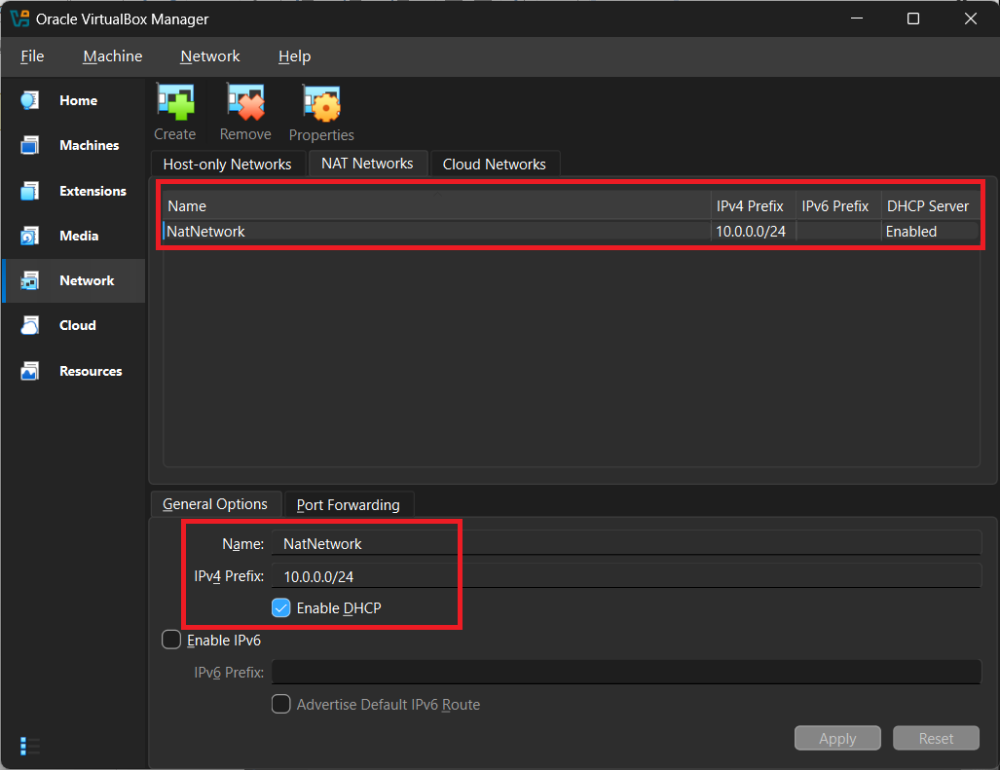
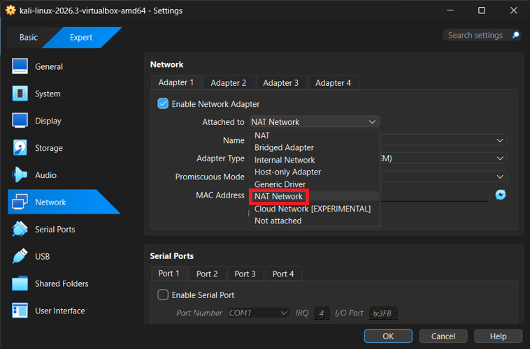
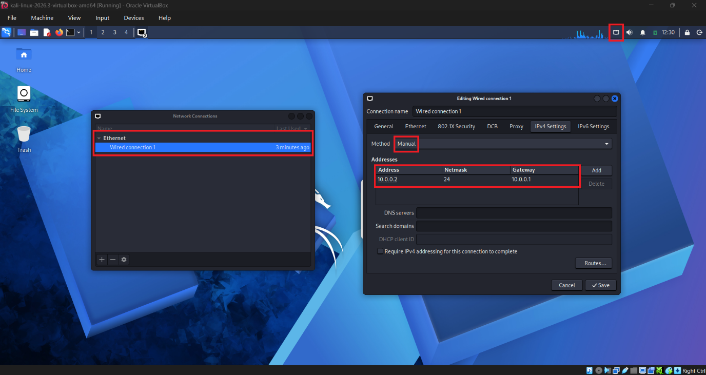
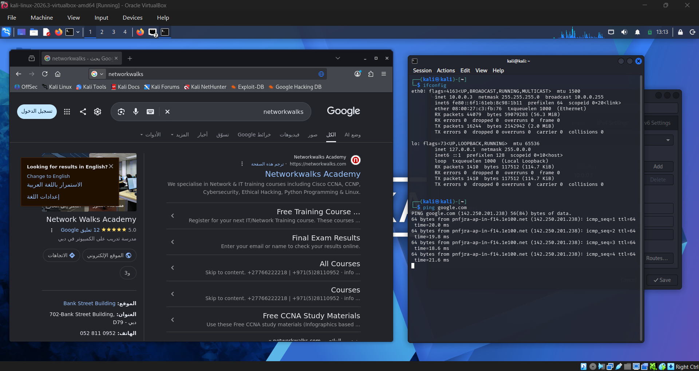
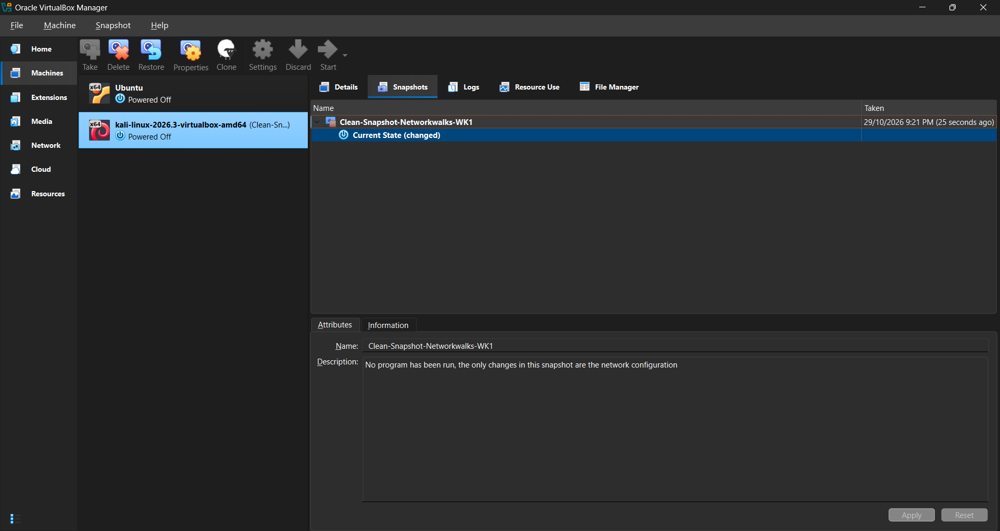

# Cybersecurity Lab Environment Setup

**Project Overview**

This project focuses on setting up a virtual cybersecurity and penetration-testing lab using VirtualBox with Kali Linux. The purpose is to create a controlled and isolated environment for various future tools, such as network scanning, cybersecurity tools, penetration testing tools, etc.
 
 
**Project Objective**

The project objective is to create an isolated and controlled virtual machine for future cybersecurity & penetration testing, and also ensure that the virtual machine has a proper internet connection and is able to access the internet when needed. The main objectives are:

- Install and configure VirtualBox.
- Install and Import Kali Linux as a virtual machine.
- Setup the network in subnet 10.0.0.0/24
- Use NAT Network with 10.0.0.0/24
- Enable clipboard & file drag/drop in Virtual Machine settings.
- Setup a shared folder with the host machine.
- Configure network connectivity for Kali Linux.
- Assign a consistent IP address to the Kali VM.
- Take a clean VM snapshot for recovery.
- Document and complete setup process.
 
 
**Tools / Resources**

Kali Linux - <https://www.kali.org/get-kali/#kali-platforms>

7-zip - <https://www.7-zip.org/>

Oracle VirtualBox - <https://www.virtualbox.org/>
 
 
**Setup Procedure**

**1. Download & Install 7-zip**

7-zip was installed to extract Kali Linux, which was a ".7z" extention/archive.

**2. Download & Install VirtualBox**

VirtualBox was downloaded and installed as the Hypervisor for Kali Linux.

**3. Download & Extract Kali Linux**

Kali Linux was downloaded and extracted using 7-zip and was moved to a separate folder called "VirtualMachine" for better organization among virtual machines.

**4. Configuring VirtualBox**

After launching VirtualMachine, I proceeded to create a new NAT Network by going to Network>NAT Network, then right-clicking on an empty space to create a new NAT Network with an IPv4 Prefix of 10.0.0.0/24.

**5. Configuring Kali Linux**

Before starting up Kali Linux, its network was changed from NAT to NAT Network.

After the network changes were done, Kali Linux was launched and was set to have a static IP address. This was done by clicking on the top right of Kali Linux to open the network connections, then, after that, NetworkConnections>Ethernet>Wire Connection 1>IPv4 Settings. After reaching the IPv4 Settings, I changed the Method to Manual and added a new IP address of "10.0.0.2", with a subnet of "24" and a gateway of "10.0.0.1"

**6. Testing connectivity**

To test the configuration, "Networkwalks" was searched in Firefox, which showed me the website, as well as pinging Google in the terminal by typing "ping google.com" returned a response. Based on these results, it is safe to concluded that the configuration performed is correct and no further changes are needed.

 
 
**Clean Snapshot**

After configuring everything in Kali Linux, a clean snapshot was saved just in case it is needed in the future.

 
 
**Problems Encountered & Solution**

During the configuration setup inside Kali Linux, I was able to configure the network settings properly, and was able to browse the internet. However, after trying different IP addresses and gateways just to experiment with Kali Linux, I lost connection and eventually got to fix it once again by changing the IP address to "10.0.0.2" and gateway to "10.0.0.1", which was originally IP: 10.0.0.11, and gateway: 10.0.0.0. Although, overall, this project has been very fun and I look forward to the next following projects with my internship.
